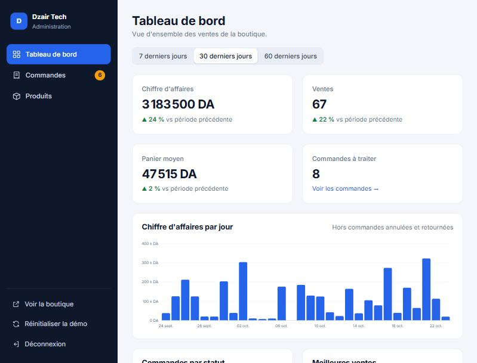

# Dzair Tech: online tech store with admin dashboard

An e-commerce site for a small Algerian electronics shop, built with **React 18**, **Vite** and **React Router**. It includes a bilingual storefront (French / Arabic) and an **admin dashboard** to manage orders and products.

> This is a demo. Data is stored in the browser, no payment is collected and no real order is placed. Contact details are placeholders.



## Storefront
- **Catalog:** 18 tech products across 6 departments (smartphones, laptops and tablets, audio, smartwatches, gaming, accessories), priced in dinars (DA).
- **Variants:** storage, color, configuration, size or edition, with price differences, color swatches and a different cart line for each combination.
- **Product pages:** specs table, 12-month warranty, stock status and related products.
- **Homepage:** hero, trust badges, category tiles, a "deal of the week" picked automatically (the biggest discount in stock), product grid with filters and sorting, shop story, reviews, FAQ and contact details.
- **Algerian checkout:**
  - All 58 wilayas, with delivery prices in 4 zones.
  - Home delivery or stop desk.
  - Algerian phone number validation.
  - Cash on delivery, and free delivery from 50 000 DA.
- **French ⇄ Arabic** with a full right-to-left layout.

## Admin dashboard (`#/admin`)
Demo login: `admin@dzairtech.demo` / `demo2026`. The login page also has an auto-fill button.

- **Overview:**
  - Revenue, sales, average basket and orders to process, compared with the previous period (7, 30 or 60 days).
  - A daily revenue chart with tooltips.
  - Orders by status, best sellers, top wilayas, latest orders and stock alerts.
- **Orders:**
  - Search by number, name, phone or wilaya, and filter by status.
  - Pagination.
  - A detail panel with customer, address and items, plus quick actions (confirm, ship, deliver, cancel).
  - Status changes directly in the table, and CSV export (opens in Excel).
- **Products:**
  - Search and filter by category.
  - Add and edit products with validation (French and Arabic names, price, discount, stock, photo from the gallery or uploaded and resized automatically).
  - Show or hide products in the shop, and delete them.
- **Live link to the shop:** a new order immediately shows up in the admin and reduces stock. Product changes appear in the shop at once, even in another tab.
- **Reset demo:** restores the original products and 150+ generated demo orders.

## How the data works
`src/store/db.js` is a small client-side database stored in `localStorage` and shared by the shop and the admin through a React hook (`useSyncExternalStore`). It holds products and orders. To connect a real backend, replace its functions (`saveProduct`, `addOrder`, `setOrderStatus`…) with API calls. The rest of the app doesn't change.

> The admin login is checked in the browser for the demo. A real site must check access on a server.

## Project structure
```
src/
  config/business.js     shop name, story, contact, hours, reviews, FAQ (FR/AR)
  data/products.js       initial catalog: variants, specs
  data/wilayas.js        58 wilayas with delivery zones
  store/db.js            shared data store (products, orders)
  store/seedOrders.js    realistic demo orders for the dashboard
  context/CartContext.jsx
  pages/                 Home, Product, Checkout, OrderSuccess
  admin/                 AdminApp (login + layout), Dashboard, Orders, Products, ProductForm
  strings.js, i18n.jsx   French/Arabic texts and helpers
```

## Run locally
```
npm install
npm run dev
```
Shop: http://localhost:5173 · Admin: http://localhost:5173/#/admin

## Build
```
npm run build
```
Deploy the `dist/` folder to any static host, such as Netlify, Vercel or GitHub Pages.

## Photo credits
Product photos come from [Wikimedia Commons](https://commons.wikimedia.org) under free licenses (CC0, public domain, CC BY, CC BY-SA). The author, license and source link for each photo are shown on its product page and listed in `src/data/credits.json`.
